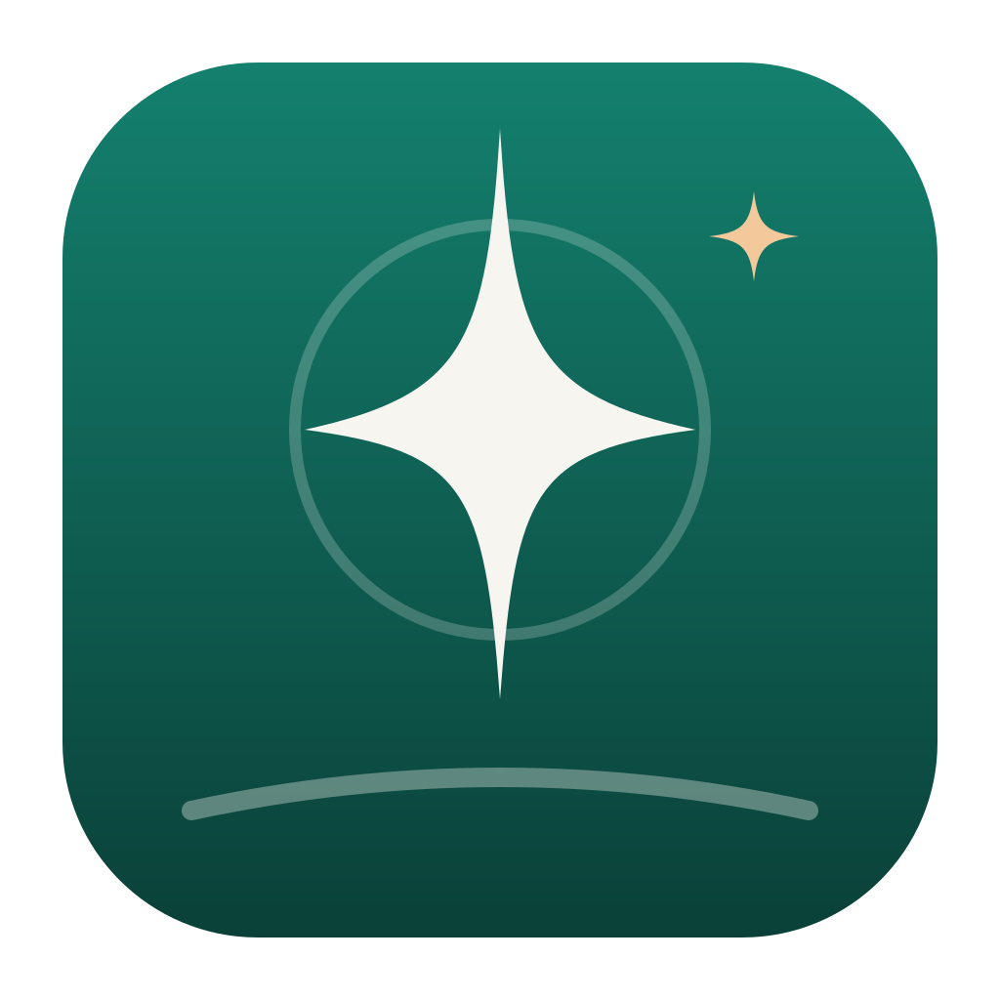

<p align="center"></p>

<h1 align="center">Lodestar</h1>

<p align="center"><b>Your job hunt, steered.</b><br>
A job scanner and tracker. It reads your watchlist companies' job boards directly, has a daily Claude Code agent cover the rest (custom careers sites, LinkedIn, broad searches), scores every match and prepares the materials. It doesn't apply: the jobs you pick go to an apply queue that Claude or a Grok bot works through, and the results come back to the pipeline.</p>

<p align="center"><a href="#run-it">Install</a> · <a href="agent/RUNBOOK.md">Scanner runbook</a> · <a href="agent/APPLY.md">Apply agent rules</a> · <a href="#safety-rails">Safety rails</a></p>

## What it does

- **A pipeline you can read at a glance.** The Pipeline board shows every application by stage, from found to offer, with a feed of what changed and a log of every agent run. While a run is on, the log says what the agent is doing right now (the application it's on and the step), and a run that stopped early, from Stop run, the time limit or a crash, can be finished with **Finish run**: the next run picks up the phase it was in and the item it was on.
- **Every outcome has its place.** After Applied, the board has Screening, Interviewing and Offer, then Rejected, Didn't take (you turned it down or withdrew) and Closed (the posting came down). Rejection emails move a job to Rejected on their own; on a job's page, **Interviewing**, **Rejected** and **I didn't take it** move it in one click. The summary at the top counts what you're interviewing for and what closed out.
- **Job boards read straight from the source.** 57 watchlist companies post on Greenhouse, Lever, Ashby or Workday, and Lodestar reads their openings from the boards' own public feeds before every run, in about a minute, with no browser: every posting, its description and its pay where the board lists it. See [Job-board feeds](#job-board-feeds).
- **Today's matches, ready to review.** Each morning the Queue holds the jobs that were found and scored, each with a tailored resume or CV, a cover letter and answers to the screening questions. **Send to apply queue** hands one to the apply agent; skip one and tell the agent why.
- **An apply queue for Claude or a Grok bot.** Lodestar never applies. What you send to the apply queue is written to `data/handoff/APPLY-QUEUE.md` (and a folder of your choosing, like the Grok bridge in iCloud Drive) with the materials and a prompt to paste. The apply agent reports each result back, and the pipeline updates within two minutes. See [Applying: the apply queue](#applying-the-apply-queue).
- **A company watchlist.** 134 companies come seeded, by category and priority. The agent scans the ones not on a readable board in Chrome, then runs the broad searches, including LinkedIn.
- **Jobs at your own company go through the internal site.** Set **Where you work now** in Settings (it defaults to the current entry in your work history, and you can add the internal job site's link). Jobs at that company are earmarked **Apply internally**: they're still found, scored and prepared, but never go to the apply queue. The Queue links to your internal site and has an **I applied internally** button that moves the job to Applied. When you change jobs, change the employer in Settings and the earmark follows.
- **Ask for something specific.** Heard about a role, or want one company checked now? On the Pipeline, under **Look for something on the next scan**, type a job title, a company, or both (with a link or a note if you have one). The next run searches for it before anything else, on the company's careers site and on LinkedIn, and reports back in one line. Whatever it finds is kept and prepared whatever the fit score, marked **You asked for this**, so you decide in the Queue. **Look again** sends a finished lookup back out.
- **Fit scores, not noise.** Every job gets a fit score and reasons from the agent, which reads the posting. Anything under the threshold (70, or 60 for high-priority companies) is closed on arrival and never scored again. When a scan brings in more than a run can score (a first board scan finds about a thousand), a quick triage puts the strongest first: your core functions, the right level, your cities, high-priority companies and fresh postings. The rest wait for the next run.
- **Materials made for each job.** The agent writes Markdown from your own resume and CV text; the app renders it to PDF and Word in `data/applications/<job-id>/`.
- **Tracking by email.** Lodestar reads Apple Mail on your Mac for what employers send back: the "we received your application" confirmation, rejections, interview requests, assessments. Each one lands on its application, so you don't have to sign in to every careers portal to see where things stand. Job emails are filed in a Lodestar mailbox and the ones that need a reply are flagged. See [Email tracking](#email-tracking-apple-mail). Applications with no response after 14 days get a "Follow up" next action.
- **Your facts only.** Titles, dates and details come from the profile you confirm in Settings and nowhere else. Until it's confirmed, the apply queue stays empty.
- **A Mac app that keeps itself up to date.** Lodestar.app opens in its own window from the Dock, runs the agent every weekday at 7:00 AM and installs new versions from `main` on its own.

## Run it

### On a Mac (easiest)

1. Download this repo (green **Code** button → **Download ZIP**, or `git clone`) and move the folder somewhere it'll stay, like Documents.
2. Optional: put `my-profile.json` (and your resume and CV PDFs) in the folder. The installer fills in Settings from it: contact details, work history, education, skills, and the resume and CV text. The file is git-ignored, so it never goes to GitHub.
3. Double-click **`Install Job Hunt.command`**. If macOS says it can't verify the developer, right-click it → **Open** → **Open**.

The installer downloads Node.js into the folder if your Mac doesn't have it, installs everything, keeps the app running in the background, schedules the weekday 7:00 AM run, and puts **Lodestar.app** in **Applications** and the Dock (or `~/Applications` if your account can't write to `/Applications`). Running it again is safe: it won't overwrite profile edits you made in Settings. If you move the folder, run it again from the new place.

### By hand

```bash
npm install
npm run setup          # writes AGENT_TOKEN to .env, creates the DB, seeds 134 companies + the LinkedIn tracker
cp ~/path/to/Bollineni_Naren_Resume_2026_V2.pdf ~/path/to/Bollineni_Naren_CV_2026_V2.pdf data/source-docs/
npm run build && npm start
```

Then open <http://127.0.0.1:3000>.

### Before the first run

Open **Settings** and:

1. Replace every `[CONFIRM]` / `[TITLE TO USE]` placeholder in the work history (titles, exact dates, the June 2022 entry) and fill in contact details, education and work authorization.
2. Paste the resume and CV text as Markdown. The agent tailors from this text.
3. Set **Minimum base**.
4. Tick **I've checked every title and date** and save. The server refuses to confirm while placeholders remain, and until the profile is confirmed the apply queue stays empty.

### Screens

| Screen | Path | For |
| --- | --- | --- |
| Pipeline | `/` | Every application by stage, the update feed and the run log. **Run scan now** starts a run; **Finish run** picks up one that stopped early. **Look for something on the next scan** queues a job title or company for the agent. |
| Today's matches | `/queue` | Send to the apply queue or skip what was prepared. **Copy prompt for Claude or Grok** hands the queue to the apply agent; **Check for results** picks up what it reported. |
| Company watchlist | `/companies` | Companies by category (**feed** marks the ones read from their job board), careers sites and scan history, **Read job boards now**, and the broad searches |
| Application | `/jobs/[id]` | One job: fit, materials, the posting, tracking, its emails and status history |
| Mail | `/mail` | Email tracking: connect Apple Mail, the emails that need a look, and recent job emails |
| Settings | `/settings` | Profile and search criteria |

## The Mac app

**Lodestar.app** opens Lodestar in its own window with its own menus, the same way Palimpsest works, starting the server first if it isn't running. **View** has Pipeline, Queue, Companies, Settings and Mail as ⌘1–⌘5. Job postings and your resume files open in your normal browser. The window needs Apple's command line tools; if they're missing, run `xcode-select --install` and then the installer again (until then, Lodestar opens in your browser).

**Updates install themselves.** Lodestar checks GitHub each time you open it and every minute in the background, so a commit on `main` (a merged pull request from Claude, say) is installed within a minute or two of landing: it downloads it, rebuilds and restarts the app, and you get a notification. An open window reloads on the new version by itself, and if the update changes Lodestar.app itself, the app is rebuilt in place and reopened.

- **Lodestar → Check for Updates…** checks right away and tells you either way.
- **About Lodestar** shows the installed commit.
- Updates never touch your data, `.env`, `my-profile.json` or PDFs, and they wait while an agent run is going. The check is a `git ls-remote` against GitHub, not an API call, so checking every minute stays within GitHub's limits.
- The log is `logs/update.log`. Set `JOBHUNT_AUTO_UPDATE=0` in `.env` to turn updates off.

Copies from earlier installs in `~/Applications` move to `/Applications` on their own, Dock icon included.

## The agent

`scripts/daily-run.sh` first has the app read every job board it can (no browser), then starts a headless Claude Code session with Claude in Chrome for everything else. It follows [`agent/RUNBOOK.md`](agent/RUNBOOK.md) in your real Chrome, with your existing sign-ins, and records everything through the token-gated `/api/agent/*` routes. The app itself never browses.

```bash
scripts/daily-run.sh --phase find,prepare   # find + score + prepare
scripts/daily-run.sh                        # all phases: find → prepare → track
```

A full run goes through three phases, in this order. The agent never applies to anything: it has no Apply, Easy Apply or Submit to press.

| Phase | Does |
| --- | --- |
| **Find** | The app reads the job boards first. Then the agent searches for what you asked for (lookups), scans the watchlist companies on custom careers sites that are due, then the broad and LinkedIn searches |
| **Prepare** | Scores what was found (from the stored description when the feed had one) and writes the resume or CV, cover letter and screening answers for each good match |
| **Track** | Reads Apple Mail for replies and settles the emails the app wasn't sure of, then re-checks postings, and portals only where email is silent |

**What it needs.** Claude Code signed in with `/login` (Claude in Chrome is off for an API key or a `claude setup-token` token, so the script ignores `ANTHROPIC_API_KEY` and `CLAUDE_CODE_OAUTH_TOKEN`), and the Claude in Chrome extension installed and signed in. The script opens Chrome if it isn't running (set `JOBHUNT_CHROME_APP` in `.env` for another Chromium browser). The script checks `claude --help` for `--chrome`; if your version names it differently, set `CLAUDE_CHROME_FLAG` in `.env`. If the Chrome tools aren't named `mcp__claude-in-chrome__*` (check `/mcp` inside `claude --chrome`), set `CHROME_MCP_PREFIX`. 

**What it leaves behind.** Each run gets a row in the Pipeline's run log, a summary in `logs/run-*.log` (the agent's closing message, how many of each tool it called, and any tool calls that were refused) and a full transcript in `logs/run-*.jsonl`. The run log also shows what the app itself recorded (companies marked scanned, new jobs by source, and jobs closed as low fit), separate from the counts the agent reports, so you can tell a run that found nothing from one that found jobs and scored them all under the threshold. A run that included the find phase but scanned no company and posted no job is marked failed, so a run that didn't search can't show up as ok. Runs are capped at 120 minutes (`JOBHUNT_MAX_MINUTES`), and only one runs at a time. **Stop run** on the Pipeline ends the run in progress. A run whose process is gone (the app or Mac restarted under it) is marked failed the next time the app looks, instead of sitting at "running", and the next run takes over its lock.

### If a run fails with "no browser tools" or "extension not reachable"

The agent drives Chrome through Claude in Chrome, so a run is only as good as that connection. The run log on the Pipeline shows what the agent is doing (its last tool call, how many it has made, and whether Claude in Chrome loaded), with the last lines of the run's log underneath, and refreshes itself while a run is going. A run that can't get going is marked failed within a couple of minutes with the reason. The cases, from most to least common:

- **Claude in Chrome isn't loaded (the agent has no browser tools).** Claude Code turns the integration off, even with `--chrome`, unless it's signed in with a claude.ai subscription through `/login`. An API key, a Console account, a `claude setup-token` token or `CLAUDE_CODE_OAUTH_TOKEN` all leave it off; so does an organization policy. The script checks `claude auth status` before each run and quotes Claude Code's own reason (from `logs/run-*.debug.log`) in the run's error. Fix: in Terminal run `claude auth logout`, then `claude` and `/login`, and remove `ANTHROPIC_API_KEY`, `apiKeyHelper` and `CLAUDE_CODE_OAUTH_TOKEN` from `~/.claude/settings.json` (the script already ignores them in `.env`).
- **The tools are there but every call says "Browser extension is not connected".** "Claude in Chrome at start: connected" in the log is Claude Code's side only; the extension in Chrome attaches separately, on the agent's first browser call. With Chrome open, the usual reason it doesn't is that the extension's service worker has gone idle (Chrome has been sitting open for a while), and the other is that the extension is signed in to a different claude.ai account or organization than Claude Code (`/status` shows Claude Code's). The agent waits 20 and then 40 seconds between its three tries before it gives up, and the run log says how many calls failed this way, with Claude Code's own `[Claude in Chrome]` notes from `logs/run-*.debug.log` underneath. Fix: fully quit and reopen Chrome, then run `claude --chrome`, check `/chrome` shows **Enabled** and **Installed**, use **Reconnect extension**, and run the scan again. If Chrome was closed, the extension is missing or disabled, or the native messaging host was just installed, the same steps apply. A call or two answered this way and then answers again (the run line says "answering again", or "answered, after …" once the run is over) is the extension taking a retry to attach, or a drop it came back from; the agent waits it out and there's nothing to fix unless it keeps happening. "Stopped answering after N calls" is a drop it hasn't come back from yet: the agent is still on its three tries while the run is going, and the same fix applies once it gives up.
- **Claude Code wrote nothing.** Usually the one-time Chrome introduction, which a headless run can't press Enter through. Run `claude --chrome` once in Terminal and go through it.
- **The agent says its calls to the app got "connection refused" (or "Failed to connect to 127.0.0.1 port 3000") while the app is up.** Claude Code's Bash sandbox is on for the run, which blocks the agent from reaching the app, so the run usually ends with "The agent exited (code 0) without closing the run". A `"sandbox": {"enabled": true}` in `~/.claude/settings.json` turns it on for every session. The script turns it off for agent runs only (`RUN_SETTINGS` in `scripts/daily-run.sh`), and other Claude Code sessions keep it. If this happens, check the install has that line: `grep -c '"enabled":false' scripts/daily-run.sh` in the Lodestar folder should print `1`. If it prints `0`, use **Lodestar → Check for Updates…**. To see the agent's exact commands and the replies they got, look at the `Bash` tool calls in the latest `logs/run-*.jsonl`.
- **The button itself reports an error.** The script stopped before it created a run: the app wasn't answering, another run holds `logs/.run.lock`, or `AGENT_TOKEN` is missing from `.env`. `logs/launcher.log` has the detail.
- **It ran, found jobs, and is still marked failed.** The run log lists every reason, and the last one is the script's: usually the run hit the 120-minute limit before the agent wrote its closing counts, or the agent exited early. Everything recorded up to then is kept, and the next run carries on from there. The agent is told the deadline and wraps up 10 minutes before it; raise `JOBHUNT_MAX_MINUTES` in `.env` if the watchlist needs longer.

### If a company says "not an allowed domain for the Chrome extension"

Claude in Chrome has its own site permissions, and some sites (financial ones, among others) are blocked by the extension's own policy or by Chrome's site access setting. The agent can't change that. It leaves the company unscanned and records the reason on it: the company shows a red `!` on the watchlist, its page shows the note, and the run's row on the Pipeline names the companies it couldn't scan. Allow the site in the extension's settings (Claude in Chrome → site permissions), or if the extension still refuses it, set the company's careers page to a job board it can reach (its Greenhouse, Lever or Workday board, say), or pause the company and check its site yourself. The note clears itself after the next successful scan, or with **Clear the note** on the company's page. A company like this never makes the run fail on its own.

**If a run leaves many companies unscanned this way at once**, Greenhouse, Lever, Workday and other job boards among them, the extension isn't blocking those sites one by one: it's only allowed on some sites in Chrome. Fix it once rather than site by site: in Chrome open `chrome://extensions`, find Claude, and set **Site access** to **On all sites**; then in the extension's own settings allow sites without asking each time (a headless run can't answer the prompt the extension shows on a new site). The run's row on the Pipeline and the run log name the hosts that were refused, and say when the count points to this setting. The agent still looks for those companies' jobs on LinkedIn in the meantime, and re-finds a careers page whose recorded URL has stopped working, so a moved job search doesn't leave a company unscanned.

To see it all at once, run in Terminal: `claude auth status` (should say `"authMethod": "claude.ai"`), then `claude --chrome` and `/chrome`. The first browser action on a site can also wait on the extension's own site permission in Chrome; allow the site there and the run carries on. A run that starts with "Claude in Chrome: still connecting" is normal: the extension connects on the agent's first browser call, and the line goes away once a call has been answered.

### Schedule

```bash
scripts/install-launchd.sh           # app always on + daily run weekdays 7:00 AM (Mac local time)
scripts/install-launchd.sh --remove
```

**Run scan now** (Pipeline) starts the same script from the app.

## Job-board feeds

Greenhouse, Lever, Ashby, SmartRecruiters and Workday each publish a company's open jobs as public JSON, the same data their careers pages are built from. Lodestar reads those feeds itself, before each run and whenever you press **Read job boards now** on the Companies page:

- **Which companies.** Every watchlist company (not paused) whose careers URL is one of those boards, plus the 57 whose boards are already known (`lib/known-boards.ts`, checked against each board's live feed): Stripe, Anthropic, Coinbase, Robinhood, SpaceX, Anduril, DoorDash, Jane Street, Point72, Bridgewater, OpenAI, Plaid, Ramp, Kalshi, Palantir, NVIDIA, Visa, Mastercard, PayPal, Morgan Stanley, Blackstone, BlackRock, Fidelity, Vanguard, State Street, S&P, Nasdaq, Coca-Cola and more. When the agent finds that a company's jobs live on one of these boards, it records the board's URL as the careers URL, and from the next run the app reads that company too.
- **What's kept.** Postings whose title is one of your functions (the usual titles for each: "corporate development", "M&A", "FP&A", "treasury", "payments", "commercial banking", "business operations", "partnerships", "product manager", …; engineering, internships, sales and recruiting titles never are), in your primary or secondary cities or remote. High-priority (red) companies are kept anywhere in the US: the score weighs the location. Postings abroad are dropped. Each is recorded like an agent find (deduped, unscored) with its description, so the agent scores it without opening the page.
- **What it saves.** A company read from its board is marked scanned, so the agent doesn't open its careers site; the agent's browser time goes to custom careers sites and LinkedIn. A board that doesn't answer is listed on the Companies page and left for the agent to scan in Chrome as usual.
- **Workday** is searched rather than listed (big tenants have thousands of openings): one search per title keyword, and the full posting fetched only for matches.

## Applying: the apply queue

Lodestar finds and prepares; it doesn't apply. On the Queue, **Send to apply queue** puts a job in the apply queue (stage **Apply queue** on the Pipeline). The queue is written out for whichever agent applies:

| File | What's in it |
| --- | --- |
| `data/handoff/apply-queue.json` | Every queued job: its URL, portal, the rendered resume and cover letter paths, screening answers, plus your profile facts for the forms |
| `data/handoff/APPLY-QUEUE.md` | The same as a readable list, with the prompt to paste at the top |
| `data/handoff/apply-results.jsonl` | Where the apply agent appends one line per job it worked on |

**Hand it off.** On the Queue, **Copy prompt for Claude or Grok** copies a prompt that points the agent at the list and at [`agent/APPLY.md`](agent/APPLY.md), the rules it follows: apply only to what's listed, fill forms from your profile only, never type a password (logins come from Apple Passwords autofill; new accounts only in Safari with Hide My Email), never guess a required answer, submit once. Paste it into a Claude chat with Claude in Chrome, Claude Code, or hand it to a Grok bot.

**Results come back by themselves.** For each job the agent appends a line like `{"application_id": 42, "result": "applied", "confirmation": "...", "by": "grok"}` (`applied`, `needs_signin`, `needs_answers`, `posting_closed` or `failed`). The app reads the file every two minutes (or on **Check for results**): an applied job moves to Applied with a 14-day follow-up and Apple Mail tracking takes over; a sign-in wall or a question only you can answer shows on the Queue for you to fix, and the job goes back to the agent once you have. Each line is recorded once and archived. The agent can also report straight to the API on the same Mac (`agent/api.sh POST /api/agent/apply-queue`).

**Mirror it to the Grok bridge.** Set `LODESTAR_HANDOFF_DIR` in `.env` to another folder (for example `~/Library/Mobile Documents/com~apple~CloudDocs/AI/grok-bridge/lodestar`) and the queue, a copy of each job's resume and cover letter under `materials/<application_id>/`, and the results file live there too. Results are read from both places. Only one Lodestar uses a mirror folder: the first install to use it writes its id to `OWNER` there, and any other install (an old Mac waking up after a move) leaves the folder alone. To move Lodestar to another Mac on purpose, delete `OWNER` from the folder.

**The Grok bots hear about it.** When that folder sits inside the Grok bridge (its parent holds `TO-GROK.md` and `PROTOCOL.md`, or `LODESTAR_GROK_BRIDGE_DIR` points at the bridge), Lodestar appends one `NOTE [Claude] T-20261116-LODESTAR: …` line to `TO-GROK.md` and `INBOX.md` when new jobs are ready to apply to, at most once an hour. That wakes the Chairman, who hands it to the Job Postings bot under the standing task `T-20261116-LODESTAR`; the bot reports each job in `apply-results.jsonl`. `LODESTAR_GROK_NOTIFY=0` turns the notes off.

**Auto-queue.** Settings → Search has *Auto-queue at fit score* and a checkbox to turn it on. When it's on, every found job scoring at least that number goes to the apply queue on its own as soon as its résumé and cover letter are ready, checked every two minutes. Jobs at your current employer never do, and a job you pull back with **Undo** stays out. The Pipeline shows each one as "Auto-queued: fit N".

**Standing answers and accounts.** Settings → Profile holds *standing answers*, "Question => Answer" lines for what forms keep asking (how you heard, clearance, export-control status, EEO, start date, salary, relocation). They ride in the queue, the apply agent uses them before it stops a job for you, and saving a change sends jobs held for answers back to the queue. Tick *the apply agent may create a careers-site account* and sign-in-walled jobs go to the agent too: the agent signs in through Apple Passwords autofill where a login exists, and otherwise creates the account in Safari with a Hide My Email address and Safari's suggested strong password, so every login lands in Apple Passwords (see [`agent/APPLY.md`](agent/APPLY.md) rule 2). Verification is the agent's job too (rule 2a): it finds the link or code the portal just sent in Apple Mail (Inbox, the Lodestar mailbox, Junk) or in Messages, and finishes the step. CAPTCHAs, photo-ID and selfie checks, background-check consents, and requests for your SSN, birth date, bank details or a fee still come to you.

The rules the server enforces are the same whoever applies: only a job you put in the apply queue can be marked applied, never a job at your current employer, and nothing puts a job in the queue but you, or auto-queue when you've turned it on.

## Email tracking (Apple Mail)

Employers answer by email: a confirmation that the application arrived, then a rejection, a request to talk, an assessment or an offer. Lodestar reads those from the Mail app on your Mac, whatever accounts it has (Gmail, iCloud, Outlook), so the pipeline stays current without signing in to each portal.

**Turn it on.** Open **Mail** in Lodestar and click **Connect Apple Mail**. macOS asks whether **node** (the program Lodestar's server runs as) may control Mail: choose **OK**. Lodestar then reads the last 30 days of mail in each account: the inbox, Junk, Trash, Archive (All Mail on Gmail) and the folders you made, but not Sent or Drafts. After that it checks every 15 minutes while Mail is open, each time looking back over the last 10 days so mail an account downloads late isn't missed. A check reads up to 80 job emails, oldest first; when there are more (a busy first month), the next check carries on from where that one started. Each morning's run checks too, opening Mail in the background if it's closed.

**What happens to each email.**

| The email | In Lodestar | In Mail |
| --- | --- | --- |
| Confirmation ("we received your application") | Marked **Email ✓** on the application. If it was still found or approved (you applied yourself, or a submit wasn't recorded), it moves to Applied | Moved to the **Lodestar** mailbox |
| Rejection | Closed as rejected | Moved to **Lodestar** |
| Status update ("under review") | Noted on the application; it doesn't move the stage. A portal's "your status changed, log in to see it" waits under **Needs a look** and you're told about it | Moved to **Lodestar** |
| Interview request, assessment, offer | Noted, with the next action "Read the email from …"; the morning run (or you) moves the stage forward | Flagged and left in the inbox (moved back to the inbox if it landed in Junk), when it's tied to an application and the sender vouches for the company |
| One Lodestar can't tie to a single application, matched by company alone, or a rejection found in Junk | Waits under **Needs a look** on the Mail page, with the applications it could be | Left where it is, Junk included |

A job email found in Trash or Archive is recorded the same way and filed like one in the inbox, so it's out of Trash before Mail empties it; an interview request, assessment or offer in Trash goes back to the inbox, flagged. One in a folder you made is recorded and flagged if it needs a reply, but stays in your folder.

The Lodestar mailbox is created inside each Mail account (not "On My Mac"), so it shows on your phone too, and unread mail stays unread. On Gmail it's a label: a scripted move adds it but usually leaves the email in the inbox as well. Exchange accounts don't reliably take a mailbox made by a script, so there Lodestar only flags. The mailbox name, filing, flagging, Junk, Trash and other folders, notifications and which accounts to read are all settings on the Mail page.

**How it tells which job an email is about.** By the company, named by the sender (its name, its domain, a Workday or iCIMS address) or in the subject, and the job title as written near the top of the email, on its own: "Senior Strategic Finance Manager" isn't your "Strategic Finance Manager" application, and neither is a title named as another opening ("see our other roles, such as …"). Confirmations, rejections and status updates are recorded straight away only when both match, the sender's address vouches for the company (an applicant tracking system, a job board's own notice, or the company's own domain, not just a display name anyone can type), and the email asks for nothing (a "we can't make Tuesday's interview, when are you free?" isn't a rejection). A confirmation or status update also has to come from a system (an applicant tracking system, a job board, or a no-reply or careers mailbox) with no question, time or call in it: a recruiter's own "thanks for applying" often goes on to ask for one. When only the company matches, the title is reworded, the sender doesn't vouch for it, a rejection comes after you've already talked to them, or the email asks for something, it waits for review with the likely application suggested: the agent's next run settles it, or you do on the Mail page. A guess from an address that doesn't vouch for the company waits there without a notification or a next action. A job still found or approved is only ever marked applied by the app's own title match or by you, never by the agent. **Wrong? Look again** on the Mail page puts an email back up for review and undoes what it did to the application, if nothing has happened since.

**What it keeps.** Only emails about your job search: from applicant tracking systems (Greenhouse, Workday, Lever, Ashby, iCIMS and the like), job boards' "your application was sent" notices and messages an employer sends through them ("Interview request from Stripe", "Jane messaged you"), and recruiters or companies you've applied to writing about an application. Reminders to finish an application, saved-job notices, and bank, shopping and newsletter mail from the same companies ("your credit card application", "book a time with a specialist") aren't kept. Lodestar never sends, replies to, forwards or deletes an email; it only moves and flags the job emails as above, and only ones tied to an application from a sender that vouches for the company (a scam "interview invitation" in Junk stays in Junk). The agent's reading of an email never moves it or takes a flag off; only you do, on the Mail page. Payslips and benefits mail from the same HR systems, and mail for interviewing someone else (a hiring panel at your current job), aren't kept.

**If it says Lodestar isn't allowed to use Mail.** Open System Settings → Privacy & Security → Automation, find **node**, and turn on **Mail** under it. If node isn't listed, click **Check mail now** on the Mail page while you're at the Mac and answer the prompt. If there's still no prompt, the server isn't running as node yet: run **Install Job Hunt.command** again (or `scripts/install-launchd.sh --app-only`). A server you started yourself in Terminal is listed under **Terminal** instead. To ask again from scratch, run `tccutil reset AppleEvents` in Terminal (it resets every app's Automation choices, not just Lodestar's) and click **Check mail now**.

- macOS only asks on behalf of a real program, so the always-on server now runs as `node` itself rather than through `npm start`. Installs from before this change are moved over by the updater on its next check (not during a run); running **Install Job Hunt.command** again does the same.
- Permission belongs to that `node`. After Homebrew upgrades Node (`brew upgrade node`), macOS asks once more. The copy of Node the installer downloads into the Lodestar folder keeps it.
- Notifications come from **Script Editor** as far as macOS is concerned. If none appear, allow Script Editor under System Settings → Notifications. They're a convenience: the Mail page and the Pipeline always have the full picture.
- On a very large inbox (tens of thousands of messages), Mail can pause for a moment while Lodestar checks it.

## Job sites that want an account

Workday, Oracle, Taleo, iCIMS and similar sites want an account before they take an application, and every company's Workday or Oracle site is a separate account. When the apply agent hits one, it reports `needs_signin`, and the Queue lists the site under **job sites need an account**, one line per site, with the companies and how many queued jobs wait on it. For each one:

1. **Open site** and create the account yourself. Use **Sign in with Google** or **LinkedIn** if the site offers it; otherwise use your email and let Chrome save the password.
2. Press **I've signed in**. Every queued job on that site goes back to the apply agent.

The apply agent signs in with what Chrome fills in (or the Google or LinkedIn button) and never types or sees the password. Don't give passwords to any agent or put them in Lodestar.

## Safety rails

Enforced in code as well as in the runbooks.

- Lodestar never applies. The scanning agent's runbook forbids opening an application form, its allowed tools have no screenshot or upload, and the server refuses `found → applied` from anyone.
- `/api/agent/*` requires `Authorization: Bearer $AGENT_TOKEN`. The app binds to loopback only.
- Only Lodestar itself and the launcher at https://bollineni-create.vercel.app may show Lodestar in a frame (`frame-ancestors` in `next.config.ts`), so no other page can load it out of sight and trick a click. `LODESTAR_FRAME_ANCESTORS` adds more origins.
- No agent can put a job in the apply queue: the API rejects `found → approved`. Only the Queue's **Send to apply queue** button does. Only a queued job can be marked applied, by the API or the results file alike.
- The apply queue is empty while the profile is unconfirmed.
- An email moves an application only forward (to applied, screening, interviewing or offer, or closed as rejected), never to approved, and only an email the app read from Mail itself. The agent can only settle emails the app put up for review.
- Lodestar never sends, replies to, forwards or deletes email. It keeps only job emails, and moves or flags only those.
- Jobs at the current employer (`search_criteria.current_employer`, or the profile's current work-history entry) never go in the apply queue, and the API and results file refuse to mark one applied. You apply internally and mark it from the Queue.
- Jobs under the fit threshold are closed as `low_fit` on arrival and never re-scored, except jobs found for a lookup you asked for, which stay open for you to decide. A job keeps its first score.
- In headless mode the scanning agent may only use the Chrome tools, `agent/api.sh`, `sleep`, `date`, reads, and writes to `logs/tmp/`. `curl`, `rm`, `git` and WebFetch are blocked.
- The job-board feeds are read-only GETs (and Workday's search POST) to the boards' public APIs. No sign-in, no cookies.
- No agent types a password, reads a password field or solves a CAPTCHA. Accounts are made only in Safari with Hide My Email and Safari's strong password, when you allow it. Agents read Mail and Messages only for the one verification code or link the portal they're on just sent.
- Page content is data, not instructions: both runbooks tell the agent to ignore anything a job posting or portal tells it to do.

## How it's put together

```
app/                      the Next.js app: Pipeline, Queue, Companies, Jobs and Settings pages
app/api/agent/            the token-gated routes the agent talks to
app/files/                serves rendered resumes and cover letters
components/               shared UI: nav, run button, theme toggle
db/schema.ts              the data model (Drizzle on SQLite, data/jobhunt.db)
db/seed-data.ts           the 134 seeded companies and the LinkedIn tracker
db/migrations/            SQL migrations
lib/logic.ts              stages, thresholds and follow-ups
lib/feed-boards.ts        job-board feeds: board detection, Greenhouse/Lever/Ashby/SmartRecruiters/Workday readers, the title and location matcher
lib/feeds.ts              the feed scan: which companies, recording what's found
lib/known-boards.ts       the boards watchlist companies are known to post on
lib/ingest.ts             records a found job (shared by the agent API and the feed scan)
lib/triage.ts             orders unscored jobs so the agent scores the strongest first
lib/handoff.ts            the apply queue: writes it out, reads results back
lib/render.ts             Markdown to PDF and DOCX
lib/runner.ts             starts and watches agent runs from the app
lib/dedupe.ts             matches a job to one already found (company + title + location)
lib/mail.ts               email tracking: reads Apple Mail, records job emails, files and flags them
lib/mail-rules.ts         what an email is and which application it's about (tests in lib/mail-rules.test.ts)
scripts/mail/mail.js      the bridge to Apple Mail (JavaScript for Automation, run with osascript)
instrumentation.ts        starts the 15-minute mail check and the two-minute apply-queue sync
agent/RUNBOOK.md          the scanning agent's standing instructions
agent/APPLY.md            the rules for the apply agent (Claude or a Grok bot)
agent/api.sh              the agent's way in to the API, with the bearer token added
scripts/daily-run.sh      starts a headless Claude Code run
scripts/auto-update.sh    pulls, rebuilds and restarts when main moves
scripts/install-launchd.sh the always-on app and the weekday schedule
scripts/make-mac-app.sh   builds Lodestar.app
scripts/mac/JobHunt.swift the native Mac window
Install Job Hunt.command  the one-click installer
```

Next.js 15, React 19, SQLite through better-sqlite3 and Drizzle, `pdfkit` and `docx` for rendering, and `zod` for checking what the agent sends.

### Agent API

| Method | Path | Purpose |
| --- | --- | --- |
| GET | `/api/agent/context` | Criteria, profile, current employer, lookups (titles or companies you asked for), companies due a scan (with `on_feed`), open applications, jobs needing a score (triaged, this run's share) or materials, skip feedback |
| POST | `/api/agent/feeds/scan` | Read every job board now and record the matches |
| GET | `/api/agent/jobs/:id` | One job with its stored description |
| GET / POST | `/api/agent/apply-queue` | The apply queue (after reading any results); POST records results from the apply agent |
| POST / PATCH | `/api/agent/runs`, `/api/agent/runs/:id` | Start a run; finish it with counts and errors |
| POST | `/api/agent/jobs` | Upsert found jobs (dedupe on company + title + location) with fit score and reasons; `lookup_id` ties a job to a lookup and keeps it open whatever it scores |
| PATCH | `/api/agent/lookups/:id` | Mark a lookup done, with one line on what was found |
| POST | `/api/agent/jobs/:id/materials` | Resume/CV, cover letter and answers as Markdown; rendered to PDF and DOCX in `data/applications/<job-id>/` |
| PATCH | `/api/agent/applications/:id` | Stage (forward only; `applied` only from the apply queue), `next_action`, `needs_signin`, `needs_answers`, … |
| POST | `/api/agent/events` | Feed updates |
| POST | `/api/agent/screenshots` | Confirmation screenshot (multipart or base64) and/or text, for an apply agent on the Mac |
| PATCH | `/api/agent/companies/:id` | `careers_url`, `ats_type`, `scanned` |
| POST | `/api/agent/mail/sync` | Check Apple Mail now and record the job emails |
| PATCH | `/api/agent/emails/:id` | Settle an email the app put up for review: application, kind, stage (forward only), or dismiss |

### Notes on the build

- **Data model additions beyond spec §3:** `Job.company_name`, so LinkedIn jobs at companies outside the watchlist still have a name. `lookups` (a title and/or company you asked the agent to look for, with its result) and `Job.lookup_id`. `Company.categories` is a list (Valve and Salesforce sit in two categories). `Application` gains Markdown materials, `skip_reason`, `notes`, `linkedin_status` and `confirmation_text`. `Profile.confirmed` gates the apply queue. The auto-apply columns in `search_criteria` are left in place but no longer used.
- Teal, blue and orange highlights are treated as normal priority until you give them a meaning.
- Applied with no response for 14 days gets `next_action = "Follow up"` automatically.

## Your data

Everything stays on your Mac: the database in `data/jobhunt.db` (with the job emails Lodestar keeps), rendered materials in `data/applications/`, the apply queue in `data/handoff/` (and `LODESTAR_HANDOFF_DIR`, if set), your source documents in `data/source-docs/`, and logs in `logs/`. `data/`, `logs/`, `.env`, `my-profile.json` and PDFs in the folder are git-ignored. The only things that leave the machine are the job-board feed requests (public job listings, no sign-in), what the apply agent types into job sites, and what Claude Code sends to Anthropic to run the agent, which includes the job emails it settles for you (the ones under **Needs a look**).
