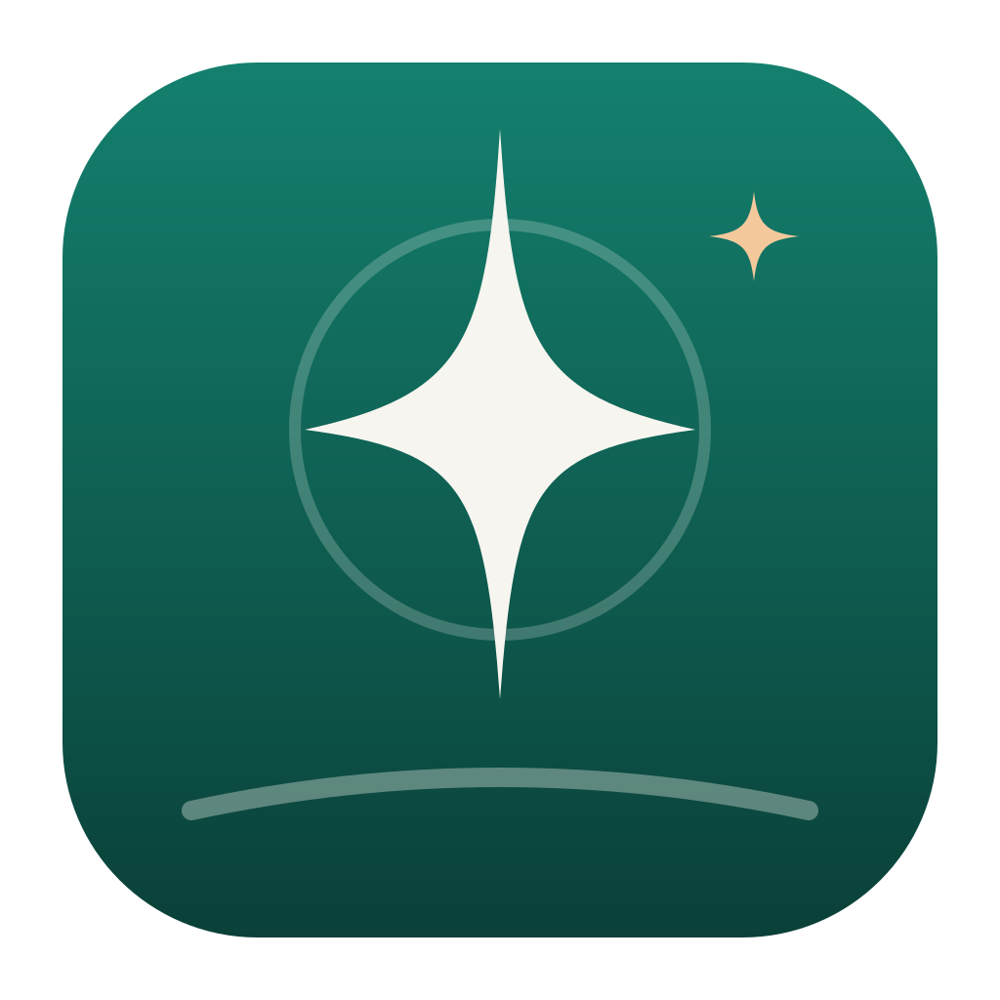

<p align="center"></p>

# Lodestar

Your job hunt, steered. A local app that tracks the job search, plus a daily Claude Code agent that finds jobs, prepares applications and submits the ones you approve, or, with auto-apply on, the strong matches on its own. Built from `JOB_HUNT_SPEC.md`.

- **App:** Next.js + SQLite (`data/jobhunt.db`), on `127.0.0.1:3000`. Screens: Pipeline `/`, Today's queue `/queue`, Company watchlist `/companies`, Application detail `/jobs/[id]`, Settings `/settings`.
- **Agent:** `scripts/daily-run.sh` starts a headless Claude Code session with Claude in Chrome, which follows `agent/RUNBOOK.md` and talks to the token-gated `/api/agent/*` routes. The app itself never browses.

## Setup (Mac)

**Easiest:** download this repo (green **Code** button → **Download ZIP**, or `git clone`), move the folder somewhere it'll stay (e.g. Documents), and double-click **`Install Job Hunt.command`**. If macOS says it can't verify the developer, right-click it → **Open** → **Open**. It downloads Node.js into the folder if your Mac doesn't have it, installs everything, keeps the app running in the background, schedules the weekday 7:00 AM agent run, and puts **Lodestar.app** in `~/Applications` and the Dock. Clicking it opens Lodestar in its own window with its own menus (View → Pipeline, Queue, Companies, Settings as ⌘1–⌘4), the same way Palimpsest works, starting the server first if needed. Job postings and your resume files open in your normal browser. The window needs Apple's command line tools; if they're missing, run `xcode-select --install` and then the installer again (until then, Lodestar opens in your browser). **Your profile:** put `my-profile.json` (and the resume/CV PDFs, optional) in the folder before running the installer and it fills in Settings for you: contact details, work history, education, skills, and the resume/CV text. The file is git-ignored, so it never goes to GitHub. **Updates install themselves:** every 15 minutes a background job checks GitHub, and when `main` has a new commit it downloads it, rebuilds, and restarts the app (you get a notification). It never touches your data, `.env`, `my-profile.json` or PDFs, and it waits while an agent run is going. Its log is `logs/update.log`; set `JOBHUNT_AUTO_UPDATE=0` in `.env` to turn it off. Running the installer again is still safe; it won't overwrite profile edits you made in Settings. If you move the folder, run it again from the new place.

Manual setup:

```bash
npm install
npm run setup          # writes AGENT_TOKEN to .env, creates the DB, seeds 134 companies + the LinkedIn tracker
cp ~/path/to/Bollineni_Naren_Resume_2026_V2.pdf ~/path/to/Bollineni_Naren_CV_2026_V2.pdf data/source-docs/
npm run build && npm start
```

Then open http://127.0.0.1:3000/settings and:

1. Replace every `[CONFIRM]` / `[TITLE TO USE]` placeholder in the work history (titles, exact dates, the June 2022 entry) and fill in contact details, education and work authorization.
2. Paste the resume and CV text as Markdown. The agent tailors from this text.
3. Set **Minimum base**.
4. Tick **I've checked every title and date** and save. Until the profile is confirmed, the agent won't fill or submit any form. The server also refuses to confirm while placeholders remain.

## Running the agent

```bash
scripts/daily-run.sh --phase find,prepare   # first run: find + score + prepare, no submitting (build order step 6)
scripts/daily-run.sh --phase submit         # submit what you approved
scripts/daily-run.sh                        # all phases: submit → find → prepare → track
```

Requirements: Claude Code signed in, with Chrome open and the Claude in Chrome extension connected. The script checks `claude --help` for `--chrome`. If your version names it differently, set `CLAUDE_CHROME_FLAG` in `.env`. If the Chrome tools aren't named `mcp__claude-in-chrome__*` (check `/mcp` inside `claude --chrome`), set `CHROME_MCP_PREFIX`. For confirmation screenshots, give your terminal (and `/bin/bash` for launchd) Screen Recording permission. Without it, the agent saves the confirmation text instead.

Each run gets a row in the Pipeline's run log, a summary in `logs/run-*.log` (the agent's closing message, how many of each tool it called, and any tool calls that were refused) and a full transcript of every step in `logs/run-*.jsonl`. The run log also shows what the app itself recorded for the run (companies marked scanned, new jobs by source), separate from the counts the agent reports. A run that included the find phase but scanned no company and posted no job is marked failed, so a run that didn't search can't show up as ok. Runs are capped at 120 minutes (`JOBHUNT_MAX_MINUTES`), and only one runs at a time.

### Schedule

```bash
scripts/install-launchd.sh           # app always on + daily run weekdays 7:00 AM (Mac local time)
scripts/install-launchd.sh --remove
```

**Run now** (Pipeline) and **Submit approved now** (Queue) start the same script from the app.

## Auto-apply

Off by default. Turn it on under **Settings → Search criteria → Auto-apply** to let the agent submit applications by itself, on company careers sites and on LinkedIn (Easy Apply, or the company site LinkedIn links to). A job is auto-applied only when the server agrees that:

- the profile is confirmed and the job's source is ticked;
- the fit score is at least the auto-apply score (default 85) and the company's normal threshold;
- the resume and cover letter are rendered, the portal isn't flagged for sign-in, and nothing says `[NEEDS YOU: …]`;
- fewer than the daily cap (default 10) have gone out today.

Those jobs show **Auto-applies next run** in the Queue, so you can still skip one before the run. Jobs prepared during a run are auto-applied in the same run. Every auto-application gets an "Auto-applied" event and a confirmation screenshot, like an approved one. The agent still never creates accounts, types passwords or solves CAPTCHAs.

LinkedIn's user agreement restricts automated use of the site, and frequent automated Easy Apply can get an account restricted. The runbook keeps it slow (30 s or more between submissions, stop on any security check), but keep the daily cap low, or untick LinkedIn and auto-apply only on careers sites.

## Safety rails, enforced in code as well as in the runbook

- `/api/agent/*` requires `Authorization: Bearer $AGENT_TOKEN`. The app binds to loopback only.
- The agent can't approve: the API rejects `found → approved`, and `→ applied` from anything but `approved`, except `found → applied` for a job that passes the auto-apply checks above (re-checked on the server at that moment, cap included). Approval only comes from the Queue's **Approve and submit** button.
- `approved_to_submit` is empty while the profile is unconfirmed.
- Jobs under the fit threshold (70; 60 for high-priority companies) are closed as `low_fit` on arrival and never re-scored. A job keeps its first score.
- In headless mode the agent may only use the Chrome tools, `agent/api.sh`, `screencapture`, reads, and writes to `logs/tmp/`. `curl`, `rm`, `git` and WebFetch are blocked.

## Agent API

| Method | Path | Purpose |
|---|---|---|
| GET | `/api/agent/context` | Criteria, profile, companies due a scan, open applications, approved and auto-apply applications to submit, jobs needing a score or materials, skip feedback |
| POST / PATCH | `/api/agent/runs`, `/api/agent/runs/:id` | Start a run; finish it with counts and errors |
| POST | `/api/agent/jobs` | Upsert found jobs (dedupe on company + title + location) with fit score and reasons |
| POST | `/api/agent/jobs/:id/materials` | Resume/CV, cover letter and answers as Markdown; rendered to PDF and DOCX in `data/applications/<job-id>/` |
| PATCH | `/api/agent/applications/:id` | Stage, `submitted_at`, `next_action`, `needs_signin`, … |
| POST | `/api/agent/events` | Feed updates |
| POST | `/api/agent/screenshots` | Confirmation screenshot (multipart or base64) and/or text |
| PATCH | `/api/agent/companies/:id` | `careers_url`, `ats_type`, `scanned` |

## Notes on the build

- **Data model additions beyond spec §3:** `Job.company_name`, so LinkedIn jobs at companies outside the watchlist still have a name. `Company.categories` is a list (Valve and Salesforce sit in two categories). `Application` gains Markdown materials, `skip_reason`, `notes`, `linkedin_status` and `confirmation_text`. `Profile.confirmed` gates submission.
- Teal, blue and orange highlights are treated as normal priority until you give them a meaning.
- Applied with no response for 14 days gets `next_action = "Follow up"` automatically.
